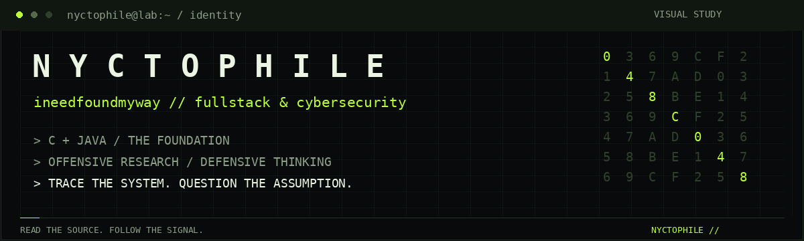
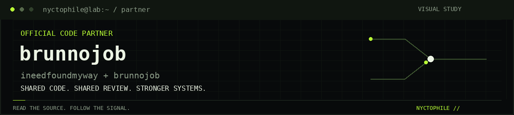
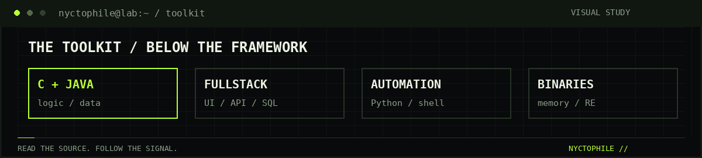
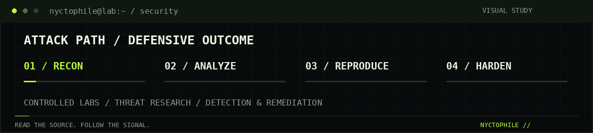

# N Y C T O P H I L E

<a href="https://github.com/ineedfoundmyway?tab=repositories">
<picture>
  <source media="(prefers-reduced-motion: reduce)" srcset="assets/terminal/identity.png" />
  
</picture>
</a>

**💻 FULLSTACK DEVELOPER & 🛡️ CYBERSECURITY RESEARCHER**

**Senior at SBM Offshore** · Logic built on **C and Java**

[🤝 PARTNER](#code-partner) &nbsp; / &nbsp; [👤 ABOUT](#about) &nbsp; / &nbsp; [🧰 STACK](#toolkit) &nbsp; / &nbsp; [🛡️ SECURITY](#security) &nbsp; / &nbsp; [🔗 CONNECT](#connect)

---

<a href="https://github.com/brunnojob">
<picture>
  <source media="(prefers-reduced-motion: reduce)" srcset="assets/terminal/partner.png" />
  
</picture>
</a>

**🤝 Official Code Partner · [@brunnojob](https://github.com/brunnojob)**

Shared code. Shared review. Stronger systems.

<strong>🔓 OPEN / partner connection</strong>

 

**ineedfoundmyway × brunnojob** — an official code partnership connecting fullstack engineering, security research, and systems thinking.

[Explore the partner profile](https://github.com/brunnojob) · [Browse the partner repositories](https://github.com/brunnojob?tab=repositories)

---

### 01 / 👤 Behind the handle

I am **nyctophile**, known here as **ineedfoundmyway**. A fullstack developer with a solid foundation in programming logic through **C and Java**, working across interfaces, backend services, databases and the systems that connect them.

My approach starts below the framework: understand the algorithm, trace the data and question the assumptions. Cybersecurity adds another lens to the same work—how a system behaves when someone uses it in a way its author never intended.

**Build it. Break down how it works. Make it stronger.**

### 02 / 🧰 The toolkit

<picture>
  <source media="(prefers-reduced-motion: reduce)" srcset="assets/terminal/toolkit.png" />
  
</picture>

| Domain | Languages & technical focus |
| :--- | :--- |
| **Programming foundation** | C · Java — logic, algorithms, data structures, object-oriented design |
| **Fullstack development** | JavaScript · TypeScript · HTML · CSS · SQL — UI, APIs and persistence |
| **Security automation** | Python · Bash · PowerShell — scripting, tooling and analysis |
| **Low-level research** | C · C++ · Assembly — memory, binaries and reverse engineering |

<strong>EXPAND / fullstack engineering</strong>

 

**Frontend** — responsive interfaces, accessible interactions and predictable application state.

**Backend** — API design, authentication, authorization, validation and service integration.

**Data** — relational modeling, query design and reliable data flows.

**Delivery** — Git, Linux, automation, observability and reproducible environments.

### 03 / 🛡️ The security mindset

<picture>
  <source media="(prefers-reduced-motion: reduce)" srcset="assets/terminal/security.png" />
  
</picture>

**🕵️ Ethical hacking. ⚔️ Offensive security. 🛡️ Cyber defense. 🧬 Black-hat technique research.**

I study both ethical and non-ethical hacking approaches to understand the difference between an intended workflow and an exploitable assumption. My technical interests include application security, adversarial thinking, reverse engineering and the relationship between an attack path and its remediation.

| Offensive perspective | Defensive outcome |
| :--- | :--- |
| Web & API attack surfaces | Stronger authentication and authorization |
| Exploitation patterns | Reproducible findings and targeted fixes |
| Binary & memory analysis | Understanding unsafe behavior and system boundaries |
| Black-hat tradecraft research | Threat awareness, detection and hardening |

<strong>EXPAND / research principles</strong>

 

- Understand attacker techniques through controlled labs and authorized assessments.
- Read the source, reproduce the behavior and document the evidence.
- Connect every finding to its impact, root cause and practical remediation.
- Treat ethical hacking and the study of malicious techniques as distinct subjects.

**Security reference:** [HackerSec](https://hackersec.com/) — offensive cybersecurity, pentesting and security research.

<strong>⚔️ OPEN / offensive research</strong>

 

**Application security** — map trust boundaries, inspect web and API behavior, and trace authentication and authorization assumptions.

**Adversarial thinking** — study ethical and non-ethical hacking approaches, exploit patterns, and black-hat tradecraft to understand how systems fail.

**Research output** — a reproducible observation, a clear explanation of impact, and a targeted fix.

<strong>🛡️ OPEN / defense console</strong>

 

**Prevention** — least privilege, input validation, secure defaults, and explicit trust boundaries.

**Detection** — meaningful logs, behavioral signals, and evidence that explains what happened.

**Response** — investigate the root cause, contain the impact, and verify the remediation.

<strong>🧬 OPEN / reverse engineering desk</strong>

 

**C · C++ · Assembly** — memory behavior, binary structure, execution flow, and system boundaries.

Read the source where available, inspect the compiled behavior, and connect low-level observations to defensive improvements.

### 04 / 🔗 Follow the source

**C & Java at the foundation. Fullstack in practice. Security in the mindset.**

[🤝 Meet @brunnojob](https://github.com/brunnojob) · [⬆ Return to the terminal](#nyctophile-terminal)

<strong>🖥️ OPEN / session notes</strong>

 

Animations are original visual studies, not live scans or security telemetry. Open a panel to explore a topic, or click the partner banner to visit the profile.

[View the animation source](scripts/render_terminal.py)

